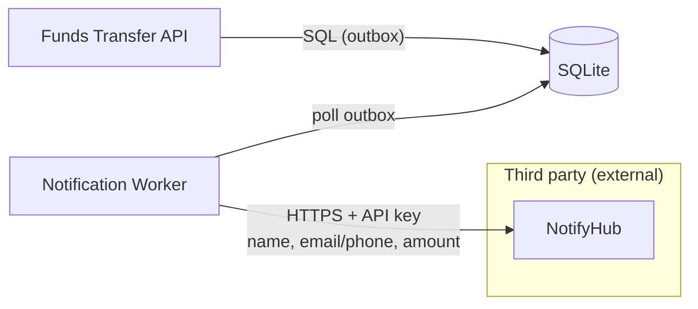

# CR-002 — Transfer Notifications via a Third-Party Provider

| | |
|---|---|
| **Applies to** | [Funds Transfer Service v1.0](../funds-transfer-spec.md). Independent of CR-001. |
| **Status** | Proposed |
| **Architecture impact** | Adds a new external dependency (NotifyHub), a new internal component (notification worker), and a new outbound data flow that carries customer personal information across a trust boundary to a third party. |

## Why

Customers who are alerted quickly to unexpected payees or transfers can report fraud before more money is lost. This CR sends an email and/or SMS alert whenever a payee is added or money is sent to a payee.

## Changes

### Notification triggers

| Event | Customer can opt out? |
|---|---|
| Payee added | No |
| Payee transfer completed | Yes, via `transfer_alerts` |

Transfers between a customer's own accounts don't trigger notifications.

### Preferences

- Each customer chooses a `channel` (`email`, `sms`, or `both`; default `email`) and sets `transfer_alerts` (default `true`).
- To support SMS, User gains a `phone_number` field (E.164 format). Seed data: Alice and Bob have phone numbers, and Sam doesn't.

### Delivery

- Notifications are sent through **NotifyHub**, a fictional third-party messaging SaaS, using `POST {NOTIFYHUB_BASE_URL}/v1/messages` with an `Authorization: Bearer {NOTIFYHUB_API_KEY}` header. The request body contains `to`, `channel`, `template_id`, and `variables`.
- Notifications use a transactional outbox: the Notification row is written in the same database transaction as the triggering event. A background **notification worker** then sends queued notifications.
- If a send fails, the worker retries up to 3 times with exponential backoff before marking the notification `failed`.
- A notification failure must never block, delay, or roll back a transfer or payee change.
- Message variables are limited to the customer's first name, the payee's nickname, the masked account number (`****4567`), the amount, the timestamp, and the bank's fraud phone number. They must never include full account numbers, balances, or memos.
- For local development, a **NotifyHub stub** runs as a separate process. It accepts the provider API and records the messages it receives.

### API

| Method | Path | Roles | Description |
|---|---|---|---|
| GET | `/me/notification-preferences` | customer | Return the caller's `channel` and `transfer_alerts` settings |
| PUT | `/me/notification-preferences` | customer | Update the caller's `channel` and `transfer_alerts` settings |

### Data model

- **User:** add `phone_number`.
- **NotificationPreference (new):** user_id, channel, transfer_alerts, updated_at.
- **Notification (new):** id, user_id, event_type, channel, template_id, variables (JSON), status (`queued` \| `sent` \| `failed`), attempts, provider_message_id, created_at, sent_at.

### Configuration

New environment variables: `NOTIFYHUB_BASE_URL`, `NOTIFYHUB_API_KEY`.

### Audit

New audited action: `notification_preferences_changed`.

### Out of scope

- Delivery-status webhooks from NotifyHub back to the bank
- Push notifications
- Customer-defined message content

## Acceptance Criteria

| ID | Criterion |
|---|---|
| CR2-AC-1 | Alice adds a payee, and the NotifyHub stub receives a message for her within 10 seconds. |
| CR2-AC-2 | Alice sends Bob $50.00 with `channel: both`, and the stub receives both an email and an SMS. |
| CR2-AC-3 | With `transfer_alerts: false`, a payee transfer sends no notification, but adding a payee still does. |
| CR2-AC-4 | If the NotifyHub stub is down, transfers still complete. Notifications are retried and then marked `failed`. |
| CR2-AC-5 | No message the stub receives contains a full account number, a balance, or a memo. |
| CR2-AC-6 | All baseline acceptance criteria still pass. |
