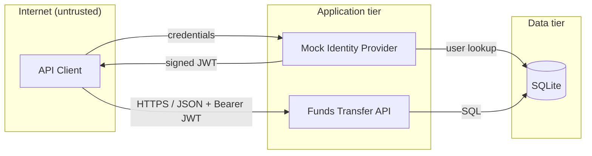

# Funds Transfer Service — Product Spec

| | |
|---|---|
| **Version** | 1.0 (baseline) |
| **Status** | Ready for build |
| **Date** | 2026-10-09 |
| **Change requests** | [CR-001](changes/CR-001-transfer-limits-step-up.md), [CR-002](changes/CR-002-transfer-notifications.md) |

## 1. Purpose

A small retail-banking API that lets customers view their accounts, manage payees, move money, and review transaction history. Bank support staff get read-only access to help customers.

This baseline is intentionally small. Later features are delivered as individual change requests (CRs), each implemented in its own pull request.

## 2. Scope

**In scope (v1.0)**

- Customer sign-in (mock identity provider)
- View own accounts and balances
- Add, list, and remove payees
- Transfer between a customer's own accounts
- Transfer to a registered payee
- Transaction history with date filtering
- Read-only access for support agents
- Audit trail of security-relevant events

**Out of scope (v1.0)**

- Real payment rails (Interac e-Transfer, wires, EFT); all transfers are between accounts held at this bank
- Foreign currency; all accounts are CAD
- Web or mobile front end; the API is exercised via Swagger UI, curl, or tests
- Account opening, KYC, statements
- Transfer limits and step-up verification (see CR-001)
- Customer notifications (see CR-002)

## 3. Users and Roles

| Role | Permissions |
|---|---|
| `customer` | View their own accounts and transactions; manage their own payees; initiate transfers from their own accounts |
| `support_agent` | View any customer's accounts and transactions. Cannot create, modify, or delete anything |

## 4. Architecture

| Component | Description |
|---|---|
| API Client | Any HTTP client (Swagger UI, curl, automated tests). Untrusted. |
| Funds Transfer API | Python 3.12, FastAPI, served by uvicorn |
| Mock Identity Provider | A module inside the API that issues signed JWT access tokens for seeded users (`POST /auth/token`). Stands in for the bank's enterprise identity provider. |
| Database | SQLite via SQLAlchemy. Holds users, accounts, payees, transfers, transactions, and audit events. |



**Deployment:** the demo runs locally. In production the service would sit behind the bank's API gateway (TLS termination) and be hosted in a Canadian region.

## 5. Data Model

Monetary amounts are stored as integer cents. In the API they're exposed as strings with exactly two decimal places (e.g. `"125.50"`). All IDs are UUIDs and all timestamps are UTC ISO 8601.

| Entity | Fields |
|---|---|
| **User** | id, username, password_hash, full_name, email, role (`customer` \| `support_agent`), created_at |
| **Account** | id, owner_id → User, account_number (7 digits), type (`chequing` \| `savings`), currency (`CAD`), balance_cents, status (`open` \| `frozen`), created_at |
| **Payee** | id, owner_id → User, nickname, payee_name, account_number, created_at |
| **Transfer** | id, from_account_id, to_account_id, payee_id (nullable), amount_cents, memo, status (`completed` \| `failed`), idempotency_key, created_by → User, created_at |
| **Transaction** | id, account_id, transfer_id, direction (`debit` \| `credit`), amount_cents, description, balance_after_cents, created_at |
| **AuditEvent** | id, timestamp, actor_id, action, target_type, target_id, source_ip, outcome (`success` \| `failure`), details (JSON) |

Each completed transfer produces two Transaction rows: a debit on the source account and a credit on the destination account.

## 6. API

Base path: `/api/v1`. Every endpoint requires a Bearer token except `/auth/token` and `/health`. Interactive docs are served at `/docs`.

| Method | Path | Roles | Description |
|---|---|---|---|
| POST | `/auth/token` | public | Exchange username/password for a 15-minute access token |
| GET | `/health` | public | Liveness check |
| GET | `/accounts` | customer | List the caller's accounts |
| GET | `/accounts/{account_id}` | customer, support_agent | Account detail and balance |
| GET | `/accounts/{account_id}/transactions` | customer, support_agent | Transaction history. Query: `from`, `to`, `limit` (≤100), `cursor` |
| GET | `/support/customers/{customer_id}/accounts` | support_agent | List a given customer's accounts |
| GET | `/payees` | customer | List the caller's payees |
| POST | `/payees` | customer | Add a payee: `nickname`, `payee_name`, `account_number` |
| DELETE | `/payees/{payee_id}` | customer | Remove a payee |
| POST | `/transfers` | customer | Create a transfer (see below). Requires `Idempotency-Key` header |
| GET | `/transfers/{transfer_id}` | customer, support_agent | Transfer detail |

**Create transfer request.** Exactly one of `to_account_id` (one of the caller's own accounts) or `payee_id` must be provided:

```json
{
  "from_account_id": "6f1c…",
  "payee_id": "a93e…",
  "amount": "125.00",
  "memo": "October rent"
}
```

**Errors** use a consistent shape: `{"error": {"code": "INSUFFICIENT_FUNDS", "message": "…"}}`. Codes include `VALIDATION_ERROR`, `UNAUTHENTICATED`, `FORBIDDEN`, `NOT_FOUND`, `INSUFFICIENT_FUNDS`, `ACCOUNT_NOT_OPEN`, `DUPLICATE_PAYEE`, `IDEMPOTENCY_CONFLICT`.

## 7. Business Rules

| ID | Rule |
|---|---|
| BR-1 | Customers can only see or act on accounts and payees they own. Requests for another customer's resources return `404`. |
| BR-2 | Support agents can read any account, transaction, or transfer, but every write endpoint returns `403` for them. |
| BR-3 | Transfer amount must be greater than 0.00, have at most two decimal places, and be in CAD. |
| BR-4 | The source account must be `open`, owned by the caller, and hold sufficient funds. Overdrafts are not allowed. |
| BR-5 | Transfers are atomic: the debit and the credit either both succeed or both fail. |
| BR-6 | `POST /transfers` requires an `Idempotency-Key` header. Re-sending the same key from the same user within 24 hours returns the original result without moving money again. Re-using a key with a different request body returns `IDEMPOTENCY_CONFLICT`. |
| BR-7 | A payee's `account_number` must belong to an existing `open` account at the bank. Customers can't add their own accounts as payees, and duplicate payees are rejected. |
| BR-8 | Account numbers are masked (`****4567`) everywhere except when the account owner views their own account. |
| BR-9 | Memo is optional, plain text, and at most 140 characters. |
| BR-10 | Transaction history defaults to the last 30 days and returns at most 100 items per page. |
| BR-11 | Removing a payee doesn't affect past transfers to that payee. |

**Audited actions:** `login_success`, `login_failure`, `payee_added`, `payee_removed`, `transfer_created`, `transfer_failed`, `access_denied`, and `support_account_viewed`.

## 8. Non-Functional Requirements

- **Configuration:** all configuration, including the JWT signing key, comes from environment variables. Nothing environment-specific is committed to source control.
- **Logging:** structured JSON logs. Passwords, tokens, and full account numbers never appear in logs.
- **Testing:** pytest suite covering every business rule and acceptance criterion.
- **Data residency (production assumption):** customer data is stored and processed in Canada.
- **Audit retention (production assumption):** audit events are retained for 7 years.

## 9. Security and Compliance Approach

This spec deliberately does **not** list detailed security controls. They're managed in two systems of record, which are kept current as the code changes:

- **SD Elements project "Funds Transfer Service":** security requirements (countermeasures) generated from the project's survey and mapped to the standards selected for the project.
- **Devici threat model "Funds Transfer Service":** components, data flows, trust boundaries, threats, and mitigations, derived from Section 4.

Compliance context: PIPEDA (personal information) and OSFI Guideline B-13 (Technology and Cyber Risk Management).

**Per-pull-request definition of done**

1. Before implementation, pull the SD Elements countermeasures and Devici threats that apply to the change.
2. If the PR adds or changes a component, data flow, external dependency, or trust boundary, update the Devici threat model.
3. If the PR changes the application's risk profile (for example, adds MFA or a third-party integration), update the SD Elements survey and triage any new countermeasures.
4. Record the countermeasures the PR addresses in SD Elements, with a link to the PR.
5. Include a short **Security impact** section in the PR description that summarizes steps 1–4.

## 10. Seed Data

| Username | Role | Accounts |
|---|---|---|
| `alice` | customer | Chequing `4012345`: $5,000.00 · Savings `4012346`: $20,000.00 |
| `bob` | customer | Chequing `4019876`: $2,500.00 |
| `sam` | support_agent | none |

Seed passwords are for local development only and are documented in the app's README.

## 11. Acceptance Criteria

| ID | Criterion |
|---|---|
| AC-1 | Alice transfers $100.00 from chequing to savings. Both balances update and two transactions are recorded. |
| AC-2 | Alice adds Bob's chequing account as a payee and sends him $50.00. Bob's balance increases by $50.00. |
| AC-3 | Alice requests Bob's account and receives `404`. |
| AC-4 | A transfer larger than the available balance is rejected with `INSUFFICIENT_FUNDS`, and no balances change. |
| AC-5 | Re-sending a transfer with the same `Idempotency-Key` returns the original transfer and doesn't debit twice. |
| AC-6 | Sam can view Alice's accounts and transactions but receives `403` on `POST /transfers` and `POST /payees`. |
| AC-7 | Each audited action in Section 7 writes an AuditEvent. |
| AC-8 | The full test suite passes. |

## 12. Planned Change Requests

| CR | Title | Nature of change |
|---|---|---|
| [CR-001](changes/CR-001-transfer-limits-step-up.md) | Daily transfer limits and step-up verification | Business logic and authentication flow. No new components. |
| [CR-002](changes/CR-002-transfer-notifications.md) | Transfer notifications via a third-party provider | New external dependency, data flow, and trust boundary |
